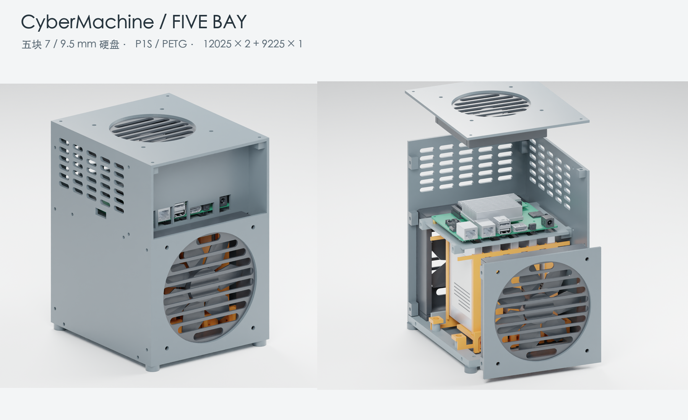

# CyberMachine

CyberMachine 是一个 NAS 设备硬件设计仓库，保存机箱结构、可编辑 CAD 模型、3D 打印文件、装配说明、五金清单和交互结构图。

**[在线查看 3D 交互结构图](https://arasaka-academy.github.io/CyberMachine/)** · [3D 装配教学](https://arasaka-academy.github.io/CyberMachine/docs/assembly/r2/) · [浅色主题](https://arasaka-academy.github.io/CyberMachine/docs/anatomy/r2/index-light.html) · [发布说明](docs/github-pages.md)

当前设计基于 **Radxa Taco V1.61 + Raspberry Pi CM5**，采用五盘位 2.5 英寸 SATA 硬盘布局。R3候选五盘均固定为用户确认的7 mm；R1/R2保留原7/9.5 mm资料。CyberMachine 是设备与项目名称，Radxa Taco 是所用主板平台。



## R1设计概况

| 项目 | 规格 |
| --- | --- |
| 主板平台 | Radxa Taco V1.61，搭配 Raspberry Pi CM5 |
| 硬盘 | 5 × 2.5 英寸 SATA，7 / 9.5 mm，可混装 |
| 机箱主体 | 144 × 168 × 210 mm，脚垫另加 6 mm |
| 风扇布局 | 前后各 120 × 120 × 25 mm，顶部 92 × 92 × 25 mm |
| 打印配置 | Bambu Lab P1S，0.4 mm 喷嘴，PETG |
| 设计内容 | 机箱、导轨、托脚、垫片、主板支架、风扇安装与维护空间 |

## 版本状态

| 版本 | 仓库现有资料 | 验证边界 |
| --- | --- | --- |
| R1 | CAD 源码、机箱 STEP、3MF、STL、装配说明与数字验证报告 | 有几何、干涉、网格与切片历史记录；已有安装问题反馈，未完成实物验收 |
| R2 | 交互结构图、每盘四点固定示意、五章 3D 装配教学与练习、操作预览及数字审计 | 主板采用原厂 STEP；尚无 R2 制造 STEP、打印项目或实物试装 |
| R3 Final 2026-11-24 | [独立装配指南](docs/design/r3/final-guide.md)、[五盘原生3MF](hardware/enclosure/r3/print/CyberMachine-r3-final-20261124-p1s-petg.3mf)、[总成STEP](hardware/enclosure/r3/cad/CyberMachine-r3-final-20261124-enclosure.step)、[STL ZIP](hardware/enclosure/r3/print/CyberMachine-r3-final-20261124-stl.zip)、[3D审阅](docs/design/r3/index.html) | 9件主体、5盘P1S/PETG数字定稿；实物打印、配合、强度与散热待验证 |

R1 托脚方案与 R2 四点螺丝固定方案有区别。使用 R1 打印资料时按 R1 装配说明操作，交互图的展示位移不能作为装配行程。

2026-11-23 已收到实际安装反馈：R1 零件与装配步骤过多，主板正反面元件妨碍固定件安装。R3 采用一体底壳、整体上盖和箱外预装内骨架，取消横跨板底的托板。此前的数字检查没有覆盖实物焊脚高度、完整工具空间与制造公差；不能据此否定安装反馈。主板净空的新检查与限制见 [R3 验证记录](validation/r3/README.md)。

2026-11-24 根据「板背元件顶住支架」继续精修。R3 按原厂前端面重做七组 I/O，纠正按钮标注并补回竖向 USB-C 开孔和开放壳。内骨架改为桁架，盘托改为接触框与螺丝短肩。页面新增 I/O 近景与仅看骨架，仍保留8个主要打印件和19个铜套。精修前报告见 [候选基线](validation/r3/baseline-2026-11-23.json)，项目校正规则见 [viz3d-lessons.md](viz3d-lessons.md)。

同日为R3上盖增加92×14 mm薄型风扇，顶部进风、后部排风。上盖集成格栅与2 mm硬定位座，总高改为194 mm，散热器设计包络上方留5.2 mm，主体打印件仍为8件。14 mm须包含原厂软角垫；R1的92×25 mm顶扇不适配当前R3高度。顶扇随上盖拆下，拆盖需先断电并断开风扇插头。几何与提盖检查见[R3验证](validation/r3/README.md)；实际供电、走线、散热和装配待验证。

顶扇与格栅现已移至上盖中心(72,100) mm；当前加宽候选前后各留26 mm、左右各留31 mm。顶部改为七道同心断环，前后通风口改为对称分段圆端槽；侧面保留完整留白。新增「背面」取景查看统一孔阵。实际STEP截片同时比较总开孔面积和后扇扫掠圆内开口，结果见[通风图案检查](validation/r3/vents.json)。图案没有增加打印主件，总高与主板基准不变。

用户确认7 mm硬盘后，R3统一为五块7 mm盘，保留SATA、负X接触面和侧螺孔基准。内框纵肋增至3.6 mm、斜撑增至8 mm，底框加高至6 mm并增加跨X横梁。主板立柱增加避让盘托的斜坡根筋，后扇立柱增至6 mm并增加四角撑。该轮8件候选作为打印优化基线保留；居中顶扇与通风图案保持。实体截面与净空见[加固检查](validation/r3/frame.json)，打印件强度和振动尚需实测。

上一轮打印优化得到9件候选：主架保持一体并采用45°尖拱，后风扇框独立平放，与风扇共用原四颗M3×35。该基线有19个铜套，整套切片估算约20小时、615克PETG，主架支撑路径由48.46降至1.77克。记录保存在[锁盖修改前基线](validation/r3/baseline-before-lid-fixing.json)。

当前锁盖加固候选保留9个主体件，改为四颗顶部M3×25、连壁厚座和盖内压套。为给M3孔壁与真实PCB直提通道留出空间，外形从144×144×194改为154×144×194 mm；主板、SATA和盘位基准保持。止口绕过厚座且保持闭合，外观缝0.30 mm、单侧间隙0.35 mm。壳底四脚增加连壁筋，主架前脚增加根板并内移侧梁。铜套改为21个（M3×17、M2.5×4）。拆盖须先完整旋出四颗盖锁螺丝。前后主通风槽采用水平等宽6 mm横带，槽端齐平于Z67/73，保留圆端和外端对称轮廓。新五盘实际切片估算21.23小时、653.48 g PETG，比锁盖前增加约1.25小时、39.01 g。当前证据见[数字验证](validation/r3/README.md)，朝向、五金与试装次序见[打印说明](docs/design/r3/printing.md)；实物强度、配合和散热仍待验证。

## 仓库结构

```text
.
├── README.md                 # 项目概况与入口
├── AGENTS.md                 # 仓库维护与 Agent 工作约定
├── SHA256SUMS.txt            # 正式文件的完整性清单
├── viz3d-lessons.md          # 三维设计校正规则与检查入口
├── .gitattributes            # 跨平台换行及原始文件字节规则
├── hardware/enclosure/r1/
│   ├── src/                  # CAD、验证、渲染及打包源码
│   ├── cad/                  # 可编辑 STEP
│   └── print/                # 3MF、STL ZIP、打印盘清单
├── hardware/enclosure/r3/
│   ├── src/                  # 参数CAD与候选验证；输出写入outputs/
│   ├── cad/                  # R3 Final 2026-11-24总成STEP
│   └── print/                # 同轮五盘3MF、STL ZIP和盘清单
├── docs/
│   ├── assembly/r1.md        # 装配、五金与打印说明
│   ├── assembly/r2/          # 离线三维教程、模型、源码与 30 秒预览
│   ├── images/r1/            # R1 设计与打印预览
│   ├── images/r2/            # R2 结构图与装配教学预览
│   ├── anatomy/r2/           # 离线 HTML、SVG、使用说明及 src/
│   └── design/r3/            # R3 一体机箱设计审阅、约束与源码
├── references/radxa-taco/    # 原厂主板参考资料
└── validation/
    ├── r1/                   # 原 R1 数字验证报告
    ├── r2/                   # 图形、装配数字验证与历史日志
    └── r3/                   # 新读取主板的净空与候选设计验证
```

目录与普通文件名使用英文；Python 文件名使用下划线，其他普通文件使用连字符。独立下载的模型与打印文件带对应的 `CyberMachine-r1-` 或 `CyberMachine-r3-final-20261124-` 前缀。

## 文件入口

| 内容 | 入口 |
| --- | --- |
| R1 装配、五金与打印说明 | [装配说明](docs/assembly/r1.md) |
| 可编辑机箱 STEP | [CyberMachine-r1-enclosure.step](hardware/enclosure/r1/cad/CyberMachine-r1-enclosure.step) |
| P1S 多盘打印项目 | [CyberMachine-r1-5bay-p1s-petg.3mf](hardware/enclosure/r1/print/CyberMachine-r1-5bay-p1s-petg.3mf) |
| 首次打印的试装件 | [CyberMachine-r1-fit-test-p1s.3mf](hardware/enclosure/r1/print/CyberMachine-r1-fit-test-p1s.3mf) |
| 分件 STL 与打印盘清单 | [STL ZIP](hardware/enclosure/r1/print/CyberMachine-r1-stl.zip) · [plate-list.csv](hardware/enclosure/r1/print/plate-list.csv) |
| CAD 源码与重建方法 | [源码说明](hardware/enclosure/r1/src/README.md) |
| R2 交互结构图 | [使用说明](docs/anatomy/r2/README.md) · [深色页面](docs/anatomy/r2/index.html) · [浅色页面](docs/anatomy/r2/index-light.html) |
| R2 3D 装配教学 | [离线教程](docs/assembly/r2/index.html) · [复现说明](docs/assembly/r2/README.md) · [30 秒预览](docs/assembly/r2/preview.mp4) |
| 验证记录 | [R1 报告](validation/r1/report.json) · [R2 原厂模型对照](validation/r2/fidelity.json) · [R2 教学验证](validation/r2/assembly-validation.md) · [R2 历史日志](validation/r2/history.log) |

## 使用方式

1. 阅读 R1 装配与打印说明，准备主板、硬盘、风扇和五金。
2. 先打印 `CyberMachine-r1-fit-test-p1s.3mf`，用实际硬盘、螺母与螺丝检查配合。
3. 试装通过后，在 Bambu Studio 中打开 R1 多盘项目，按实际耗材调整配置并重新切片。
4. 按装配说明安装；修改结构时，从 CAD 源码或分件 STEP 开始，并重新检查干涉与公差。

可在 [GitHub Pages](https://arasaka-academy.github.io/CyberMachine/) 直接操作 R2 交互结构图。下载或克隆仓库后，也可用浏览器离线打开 R2 HTML 页面；GitHub 仓库的 HTML 文件页展示源码。

## 构建与依赖

| 流程 | 环境与前置条件 |
| --- | --- |
| 离线查看 R2 | 浏览器，直接打开 HTML |
| 重建 R2 HTML / SVG | Node.js 20.10+；使用 Node 内置模块及仓库内的绘图工具，无需安装 npm 依赖 |
| 重建 R2 三维教程 | Node.js 22.12+、锁定的 npm 依赖；模型已收录，重新建模另需 OCCT 8 和 Blender 3.6，见[教程说明](docs/assembly/r2/README.md) |
| 重建 R1 CAD | Python 3.12+、OCCT 8 对应的 Python 库、NumPy、trimesh；具体版本见源码说明 |
| 验证、切片准备、渲染与打包 | 除上述环境外，分别需要 CAD 中间文件、Bambu Studio 本机配置、兼容的 Blender 环境、Pillow 和实际切片结果 |

以下命令在仓库根目录运行。重新生成 R2 深浅主题：

```sh
node docs/anatomy/r2/src/build.mjs
node docs/anatomy/r2/src/build.mjs --light
```

HTML 和 SVG 写入 `docs/anatomy/r2/`。使用 `--audit` 可重新求解遮挡顺序并检查图形几何，结果写入 `validation/r2/`。

配置好 CAD 依赖后，重建 R1：

```sh
python3 hardware/enclosure/r1/src/design.py --board-step references/radxa-taco/radxa_taco_3d_stp_v1.61.stp
```

CAD 默认以仓库根目录为工作空间，`--root` 可指定其他工作空间，`--only` 可选择原脚本中的构建步骤。中间数据写入 `work/`，新导出的 STEP 写入 `outputs/CyberMachine-r1-enclosure.step`。这两个目录均被 Git 忽略；正式资料更新前应先验证生成结果。

辅助脚本保留原交付流程，部分中间数据未入库，完整切片、渲染和打包需要额外环境。各脚本所需输入、运行方式和限制见[源码说明](hardware/enclosure/r1/src/README.md)。

## 主板参考资料

参考资料统一存放在 [references/radxa-taco](references/radxa-taco/)，保留原厂文件名与内容，便于追溯型号和版本：

- [Taco V1.61 三维模型](references/radxa-taco/radxa_taco_3d_stp_v1.61.stp)
- [Taco V1.61 原理图](references/radxa-taco/radxa_taco_schematic_v1.61.pdf)
- [Taco V1.61 器件位置图](references/radxa-taco/radxa_taco_components_placement_map_v1.61.pdf)
- [产品简介 Revision 1.2](references/radxa-taco/rad-doc-0030_radxa_taco_product_brief__revision_1.2_g4dfad65.pdf)

第三方 Anatomy 绘图工具的 MIT 许可证随源码保留，见 [kit/LICENSE](docs/anatomy/r2/src/kit/LICENSE)。

## 验证状态

`validation/r1/report.json` 保留 R1 数字检查记录；`validation/r2/` 保存交互图的几何审计、原厂 STEP 包络对照与历史日志。日期、对应源码和检查范围见各报告。普通 R2 构建不代表重新完成几何审计；需要审计时显式使用 `--audit`。

在仓库根目录校验当前正式文件：

```sh
shasum -a 256 -c SHA256SUMS.txt
```

修改源码、文档或正式产物后，按 [AGENTS.md](AGENTS.md) 的流程检查并更新根目录校验清单。

实物打印、装配配合、硬盘实际螺孔与螺纹深度，以及温升、振动、噪声和风扇供电能力仍需实测。开始整套打印前应先完成试装件验证。
