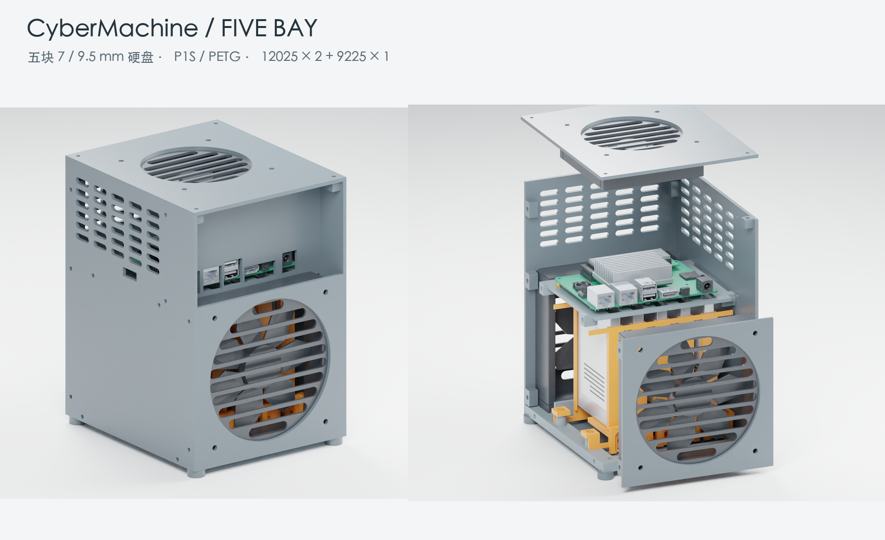

# CyberMachine

CyberMachine 是一个 NAS 设备硬件设计仓库，保存机箱结构、可编辑 CAD 模型、3D 打印文件、装配说明、五金清单和交互结构图。

当前设计基于 **Radxa Taco V1.61 + Raspberry Pi CM5**，采用五盘位 2.5 英寸 SATA 硬盘布局，支持 7 mm 与 9.5 mm 厚度硬盘。CyberMachine 是设备与项目名称，Radxa Taco 是所用主板平台。



## 设计概况

| 项目 | 规格 |
| --- | --- |
| 主板平台 | Radxa Taco V1.61，搭配 Raspberry Pi CM5 |
| 硬盘 | 5 × 2.5 英寸 SATA，7 / 9.5 mm，可混装 |
| 机箱主体 | 144 × 168 × 210 mm，脚垫另加 6 mm |
| 风扇布局 | 前后各 120 × 120 × 25 mm，顶部 92 × 92 × 25 mm |
| 打印配置 | Bambu Lab P1S，0.4 mm 喷嘴，PETG |
| 设计内容 | 机箱、导轨、托脚、垫片、主板支架、风扇安装与维护空间 |

## 版本状态

| 版本 | 仓库现有资料 | 验证边界 |
| --- | --- | --- |
| R1 | CAD 源码、机箱 STEP、3MF、STL、装配说明与数字验证报告 | 有几何、干涉、网格与切片记录；实物打印和装配仍需验证 |
| R2 | 完整外观与展开交互图、每盘四点螺丝固定示意、SVG、预览与图形审计记录 | 主板接口对照原厂 STEP；当前未收录对应的 R2 CAD、打印项目或试装件 |

R1 托脚方案与 R2 四点螺丝固定方案有区别。使用 R1 打印资料时按 R1 装配说明操作，交互图的展示位移不能作为装配行程。

## 仓库结构

```text
.
├── README.md                 # 项目概况与入口
├── AGENTS.md                 # 仓库维护与 Agent 工作约定
├── SHA256SUMS.txt            # 正式文件的完整性清单
├── .gitattributes            # 跨平台换行及原始文件字节规则
├── hardware/enclosure/r1/
│   ├── src/                  # CAD、验证、渲染及打包源码
│   ├── cad/                  # 可编辑 STEP
│   └── print/                # 3MF、STL ZIP、打印盘清单
├── docs/
│   ├── assembly/r1.md        # 装配、五金与打印说明
│   ├── images/r1/            # R1 设计与打印预览
│   ├── images/r2/            # R2 交互图预览
│   └── anatomy/r2/           # 离线 HTML、SVG、使用说明及 src/
├── references/radxa-taco/    # 原厂主板参考资料
└── validation/
    ├── r1/                   # 原 R1 数字验证报告
    └── r2/                   # 图形审计与历史验证日志
```

目录与普通文件名使用英文；Python 文件名使用下划线，其他普通文件使用连字符。独立下载的模型与打印文件带 `CyberMachine-r1-` 前缀，便于离开仓库目录后识别项目与版本。

## 文件入口

| 内容 | 入口 |
| --- | --- |
| R1 装配、五金与打印说明 | [装配说明](docs/assembly/r1.md) |
| 可编辑机箱 STEP | [CyberMachine-r1-enclosure.step](hardware/enclosure/r1/cad/CyberMachine-r1-enclosure.step) |
| P1S 多盘打印项目 | [CyberMachine-r1-5bay-p1s-petg.3mf](hardware/enclosure/r1/print/CyberMachine-r1-5bay-p1s-petg.3mf) |
| 首次打印的试装件 | [CyberMachine-r1-fit-test-p1s.3mf](hardware/enclosure/r1/print/CyberMachine-r1-fit-test-p1s.3mf) |
| 分件 STL 与打印盘清单 | [STL ZIP](hardware/enclosure/r1/print/CyberMachine-r1-stl.zip) · [plate-list.csv](hardware/enclosure/r1/print/plate-list.csv) |
| CAD 源码与重建方法 | [源码说明](hardware/enclosure/r1/src/README.md) |
| R2 交互结构图 | [使用说明](docs/anatomy/r2/README.md) · [深色页面](docs/anatomy/r2/index.html) · [浅色页面](docs/anatomy/r2/index-light.html) |
| 验证记录 | [R1 报告](validation/r1/report.json) · [R2 原厂模型对照](validation/r2/fidelity.json) · [R2 历史日志](validation/r2/history.log) |

## 使用方式

1. 阅读 R1 装配与打印说明，准备主板、硬盘、风扇和五金。
2. 先打印 `CyberMachine-r1-fit-test-p1s.3mf`，用实际硬盘、螺母与螺丝检查配合。
3. 试装通过后，在 Bambu Studio 中打开 R1 多盘项目，按实际耗材调整配置并重新切片。
4. 按装配说明安装；修改结构时，从 CAD 源码或分件 STEP 开始，并重新检查干涉与公差。

下载或克隆仓库后，可直接用浏览器离线打开 R2 HTML 页面。GitHub 文件页展示 HTML 源码；交互需要在本地打开页面。

## 构建与依赖

| 流程 | 环境与前置条件 |
| --- | --- |
| 离线查看 R2 | 浏览器，直接打开 HTML |
| 重建 R2 HTML / SVG | Node.js 20.10+；使用 Node 内置模块及仓库内的绘图工具，无需安装 npm 依赖 |
| 重建 R1 CAD | Python 3.12+、OCCT 8 对应的 Python 库、NumPy、trimesh；具体版本见源码说明 |
| 验证、切片准备、渲染与打包 | 除上述环境外，分别需要 CAD 中间文件、Bambu Studio 本机配置、兼容的 Blender 环境、Pillow 和实际切片结果 |

以下命令在仓库根目录运行。重新生成 R2 深浅主题：

```sh
node docs/anatomy/r2/src/build.mjs
node docs/anatomy/r2/src/build.mjs --light
```

HTML 和 SVG 写入 `docs/anatomy/r2/`。使用 `--audit` 可重新求解遮挡顺序并检查图形几何，结果写入 `validation/r2/`。

配置好 CAD 依赖后，重建 R1：

```sh
python3 hardware/enclosure/r1/src/design.py --board-step references/radxa-taco/radxa_taco_3d_stp_v1.61.stp
```

CAD 默认以仓库根目录为工作空间，`--root` 可指定其他工作空间，`--only` 可选择原脚本中的构建步骤。中间数据写入 `work/`，新导出的 STEP 写入 `outputs/CyberMachine-r1-enclosure.step`。这两个目录均被 Git 忽略；正式资料更新前应先验证生成结果。

辅助脚本保留原交付流程，部分中间数据未入库，完整切片、渲染和打包需要额外环境。各脚本所需输入、运行方式和限制见[源码说明](hardware/enclosure/r1/src/README.md)。

## 主板参考资料

参考资料统一存放在 [references/radxa-taco](references/radxa-taco/)，保留原厂文件名与内容，便于追溯型号和版本：

- [Taco V1.61 三维模型](references/radxa-taco/radxa_taco_3d_stp_v1.61.stp)
- [Taco V1.61 原理图](references/radxa-taco/radxa_taco_schematic_v1.61.pdf)
- [Taco V1.61 器件位置图](references/radxa-taco/radxa_taco_components_placement_map_v1.61.pdf)
- [产品简介 Revision 1.2](references/radxa-taco/rad-doc-0030_radxa_taco_product_brief__revision_1.2_g4dfad65.pdf)

第三方 Anatomy 绘图工具的 MIT 许可证随源码保留，见 [kit/LICENSE](docs/anatomy/r2/src/kit/LICENSE)。

## 验证状态

`validation/r1/report.json` 保留 R1 数字检查记录；`validation/r2/` 保存交互图的几何审计、原厂 STEP 包络对照与历史日志。日期、对应源码和检查范围见各报告。普通 R2 构建不代表重新完成几何审计；需要审计时显式使用 `--audit`。

在仓库根目录校验当前正式文件：

```sh
shasum -a 256 -c SHA256SUMS.txt
```

修改源码、文档或正式产物后，按 [AGENTS.md](AGENTS.md) 的流程检查并更新根目录校验清单。

实物打印、装配配合、硬盘实际螺孔与螺纹深度，以及温升、振动、噪声和风扇供电能力仍需实测。开始整套打印前应先完成试装件验证。
