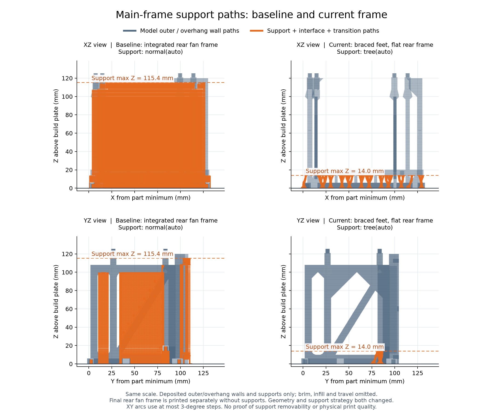

<!--
[INPUT]: R3 最终几何、五盘切片与原生工程读回结果。
[OUTPUT]: 仓库内打印工程入口、朝向、试装顺序与五金清单。
[POS]: R3 打印流程说明；final-guide.md提供独立分发正文。
[PROTOCOL]: Update this header on change, then check AGENTS.md
-->

# R3 打印与装配

本轮按P1S、0.4 mm喷嘴和PETG实际切片，冻结为R3 Final 2026-11-24数字交付。工程包含9个主体打印件，分为5盘。尚未实物打印或试装。最终原生工程为[CyberMachine-r3-final-20261124-p1s-petg.3mf](../../../hardware/enclosure/r3/print/CyberMachine-r3-final-20261124-p1s-petg.3mf)，独立上传说明见[最终指南](final-guide.md)。生成中间数据仍写入忽略目录`outputs/print-r3/`；R1正式打印项目继续保留原版本。

## 打印朝向

| 零件 | 数量 | 贴床面 | 打印包络 mm | 支撑 |
| --- | ---: | --- | --- | --- |
| 底壳 | 1 | 底面，开口朝上 | 154×144×174 | 自动树状 |
| 上盖 | 1 | 外顶面，止口朝上 | 154×144×24.7 | 自动普通 |
| 主骨架 | 1 | 底框，保持直立 | 133×106.5×125.4 | 自动树状 |
| 后风扇框 | 1 | 装配坐标Y142后面，浅键朝上 | 126×120×5.5 | 关闭 |
| 硬盘托架 | 5 | 装配坐标负X侧大框面 | 94.15×81.5×14.3 | 自动树状 |

使用`*-print.stl`表示已变换的打印姿态。底壳直接使用`shell.stl`。页面及整机STEP使用装配坐标；整机STEP不能直接切片。打印按此清单选择分件，切片程序关闭自动翻转，保留已验证姿态。

主骨架保留一体承力结构，纵框窗顶为45°尖拱。后风扇框平放后，跨距97 mm的高位横梁无需支撑。盘托由直立改为大面贴床，降低打印高度。后止挡下仍需要少量低处支撑；本方案没有声称全件免支撑。



左为旧一体后框与普通支撑，右为本轮加根板、内移侧梁后的主架与树状支撑，后框另件平放且无支撑。右图来自本轮实际G-code，最高支撑由115.4降至14 mm。图展示结构和支撑策略的共同优化，未验证实物拆支撑手感。

## 切片与打印盘

使用本机Bambu Studio 02.08.02.61内置P1S 0.4与Generic PETG预设。完整继承参数写入候选目录，保留原机型起止代码与温度配置。工艺为0.2 mm层高、4圈墙、25% gyroid填充、上下各5层、5 mm外侧brim和纹理PEI板。支撑角阈值35°，上下接触Z间隙0.2 mm，允许支撑落在模型上。

| 盘号 | 内容 |
| --- | --- |
| 01 | 底壳 |
| 02 | 倒置上盖 |
| 03 | 直立主骨架 |
| 04 | 后风扇框及2个平放盘托 |
| 05 | 3个平放盘托 |

盘号用于归档，不代表首次试装顺序。完整时间、用料、实际摆放包络与文件SHA256见[printing.json](../../../validation/r3/printing.json)。时间采用切片器的总估算，并另存模型打印时间；预热、调平和取件耗时以实际设备为准。支撑用料是G-code中支撑路径的沉积估算，排除纯挤出清料，不是实物称重。

本轮水平6 mm通风横带候选五盘估算合计21.23小时、653.48 g PETG，其中支撑路径估算21.58 g。相较锁盖修改前增加约1.25小时、39.01 g，包含横向加宽10 mm、四点锁结构及本轮横带。支撑类型沿用上一轮同预设对照的选择；当前新几何已按上述配置重新实际切片，不把旧版对照时间当作新版本结果。证据见[验证说明](../../../validation/r3/README.md)。

2026-11-24修复原生工程的支撑覆盖保存。原脚本将上盖`normal(auto)`放在盘级参数中，G-code采用普通支撑，但3MF未保存该覆盖。现将参数写入上盖物件级`print_params`，保存后的`model_settings`中`lid-print_1`明确记录`support_type=normal(auto)`；后框仍关闭支撑，其余物件使用自动树状。已重新切完五盘并通过路径复核，再从保存的3MF、不带外部设置加载五盘重切。项目设置字段保持一致，九个物件的支撑参数已读回。GUI重开未验证；不能据CLI重读重切表述为GUI验收通过。

## 先试装，再打印大件

1. 在第05盘只保留一个托架，先打印并清理支撑、brim与象脚。放入实际7 mm硬盘，检查接触面、孔位和连接器方向。使用M3×5及0.5 mm垫圈时，名义旋入2.1 mm；必须小于硬盘厂商允许深度。
2. 打印主骨架和后风扇框。清除后止挡下方、盲孔入口和支柱周围的支撑，检查两个浅键能直接就位。检查四个Ø5主板承托面，不以螺丝强行拉平零件。
3. 铜套尺寸以实际采购规格为准。先用相同PETG和孔径做热熔试片，再安装铜套。电子部件在热熔及清理之后安装。
4. 在箱外先固定主板，再装会遮挡工具的附件。检查真实板背元件、焊脚、散热器和盘托均不抵触。逐盘安装硬盘及托架，托架从下方固定。
5. 将后框浅键对准主架，把后风扇和后框用四颗M3×35共同锁紧。按实际风扇、铜套及螺丝尺寸核对孔底余量，不另加垫圈或过长螺丝。
6. 总成试装通过后再打印底壳、上盖。清理支撑后检查0.30 mm外观缝、0.35 mm单侧止口间隙、四个止口落座台和四个盖锁压套。止口绕过侧壁厚座，逐处检查支撑残留与铜套入口。顶盖大外平面与纹理PEI接触，最终表面纹理由实际打印板决定。
7. 总成整体入壳，从壳底锁四颗M3×10。顶扇在盖上单独预装后再合盖，避免在箱内拧小螺母。落盖后从顶部交替轻拧四颗M3×25，使压套贴到壳内厚座；不以螺丝强行压平翘曲件。

主架直立、底壳较高，需检查首层连续、brim牢固和PETG干燥情况。实际支撑拆除、表面质量、层间强度与翘曲没有实测结论。

本轮独立读取最终STEP，实测单盘托向下退5.85 mm时零交叠，退6 mm时与主架交叠9.54942 mm³；限制来自下方跨X底横梁。真实SATA是否在5.85 mm内完全脱开尚未验证。第4步箱外试装须增加单盘断电插拔检查；未确认脱开前不得横拉硬盘。整体总成上提通过不代表单盘独立抽换通过。

## 五金与风扇

| 用途 | 候选规格及数量 |
| --- | --- |
| 主板 | 4颗M2.5低头×6；头径≤4.5、头高≤1.5 mm，不加垫圈 |
| 上盖四角 | 4颗M3圆头×25；头径≤5.7、头高≤1.7 mm，不加垫圈 |
| 内框至底壳 | 4颗M3低头×10；沉孔Ø6.3×2.2 mm，头部须留打印余量且不凸出 |
| 盘托至内框 | 5颗M3×6；头径≤5.5 mm |
| 硬盘至盘托 | 10颗M3×5，10片0.5 mm垫圈；头及垫圈直径≤5.5 mm |
| 后风扇及后框 | 4颗M3×35；头高≤1.7 mm，不加垫圈 |
| 顶风扇 | 4颗M3圆头×20；头径≤5.7、头高≤1.7 mm |
| 顶扇下侧 | 4片OD7×0.5 mm垫圈，4颗AF5.5×1.8 mm薄M3螺母 |
| 热熔铜套 | 共21个：17个M3，4个M2.5；实际外径、长度与孔配合待试片 |

后扇为120×25 mm包络。顶扇为92×14 mm包络，14 mm包含原厂软垫；原R1的92×25 mm顶扇不能复用。风扇型号、电流、两扇供电与调速仍需选型验证。

盖锁使用完整Ø6.3×2.2 mm圆柱沉孔和Ø3.4 mm杆孔。四个壳内厚座直接连接侧壁，盖内压套在Z174 mm与厚座接触。M3×25的名义杆尖至盲底余量0.4 mm；更长螺丝会顶底。盖锁铜套孔Ø4.1×7.6 mm，5.4 mm铜套长度只作候选占位，须用实际铜套试片确认。

断电并拔下外部线缆后再维修。完整旋出四颗盖锁螺丝，再初抬上盖、断开顶扇插头，最后完整取盖。顶扇线随盖，后扇线随内部总成。三维页面中盖锁螺丝随盖升降只表达拆解关系，不表示带螺纹锁合时可以提盖。实际插头和维修余长未验证。仅轻拧至贴合，不套用钢件紧固扭矩。

## 重新生成

先按[CAD源码说明](../../../hardware/enclosure/r3/src/README.md)导出并检查网格，再从仓库根目录执行：

```sh
python3 hardware/enclosure/r3/src/slice_candidates.py
```

脚本只离线切片，不连接打印机或启动打印。中间输出为`CyberMachine-r3-print-candidate.gcode.3mf`、5份G-code、完整预设与打印盘计划；本轮最终工程保存为上方独立命名的3MF。打开最终工程后，按实际设备、耗材及打印板核对并重新切片。切片通过不等于实物装配、强度、温升、振动或噪声验收。

[PROTOCOL]: Update this header on change, then check AGENTS.md
